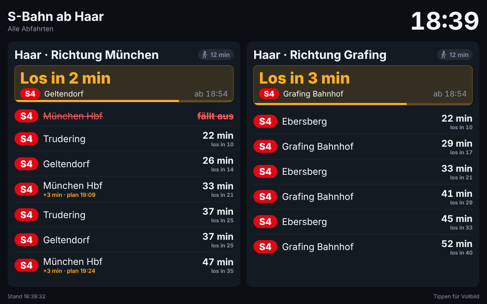

# Hösl Abfahrtstafel

Kiosk-Webapp für Tablets mit Live-Abfahrten der MVG. Es gibt zwei Tafeln:

| URL | Inhalt |
| --- | --- |
| `/hoeslhome` | U- und S-Bahnen **stadteinwärts** ab Mittersendling, Harras und Brudermühlstraße |
| `/LTHQ` | **Alle S-Bahnen** ab Haar, getrennt nach Richtung München und Richtung Grafing |

`/` leitet auf `/hoeslhome` um.




## Gehzeiten

Jede Station hat eine Gehzeit (`walkMinutes`). Daraus rechnet die Tafel, wann man losgehen muss:

- Oben in jeder Karte steht groß die **nächste noch erreichbare Abfahrt**: „Los in 6 min“ (blau),
  ab 4 Minuten gelb, und unter 90 Sekunden pulsiert „**Jetzt los!**“ grün. Der Balken füllt sich
  in den letzten 10 Minuten bis zum Losgehen.
- In der Liste steht unter jeder Abfahrtszeit „los in X“.
- Züge, die man zu Fuß nicht mehr schafft, werden ausgeblendet.

## Starten

```bash
docker compose up -d
```

Danach auf dem Tablet `http://<server-ip>:8080/hoeslhome` bzw. `/LTHQ` öffnen und über das Browser-Menü
**„Zum Startbildschirm hinzufügen“** wählen. Jede Tafel ist eine eigene App mit eigener Start-URL.
Ein Tipp auf den Bildschirm schaltet in den Vollbildmodus.

> Browser erlauben Vollbild-App, Offline-Cache und „Bildschirm wach halten“ nur über HTTPS
> (oder `localhost`). Im LAN über `http://` läuft die Tafel trotzdem; für echten Kiosk-Betrieb
> empfiehlt sich ein Reverse-Proxy mit HTTPS oder eine Kiosk-Browser-App, die den Bildschirm anlässt.

Das Image wird von GitHub Actions gebaut und unter
`ghcr.io/derpfuscher1203/hoesl-abfahrtstafel` veröffentlicht (amd64 und arm64,
läuft also auch auf einem Raspberry Pi). Updates: `docker compose pull && docker compose up -d`.
Zum lokalen Bauen statt Ziehen: `docker compose up -d --build`.

> Ist das GHCR-Paket privat, vorher `docker login ghcr.io` ausführen oder das Paket
> in den GitHub-Paketeinstellungen auf „public“ stellen.

## Immer aktuell

- Abruf alle 30 Sekunden mit 10 s Timeout; nach Fehlern wird alle paar Sekunden neu versucht.
- Ein Watchdog stößt den Abruf wieder an, falls der Timer hängen bleibt (z. B. nach Standby).
- Beim Aufwachen des Tablets, bei Netzrückkehr und bei Fokus wird sofort neu geladen.
- Startet der Container neu oder läuft eine neue Version, laden sich alle Tablets selbst neu.
- Countdown und Uhr laufen mit der Serverzeit, auch wenn die Tablet-Uhr falsch geht.
- Sind die Daten länger als 75 Sekunden alt, wird die Tafel grau und unten steht „Verbindung gestört“.
- Einmal pro Nacht lädt die Seite neu, aber nur wenn der Server erreichbar ist.

## Konfiguration

Alles steht in [`config/stations.json`](config/stations.json) und wird per Volume in den Container
gemountet; nach einer Änderung reicht `docker compose restart`. Die Datei enthält eine Liste `boards`:

| Feld | Bedeutung |
| --- | --- |
| `boards[].id` | Teil der URL (`/hoeslhome`, `/LTHQ`) |
| `boards[].title`, `subtitle` | Überschrift der Tafel |
| `boards[].transportTypes` | Verkehrsmittel (`UBAHN`, `SBAHN`, auch `TRAM`, `BUS` möglich) |
| `boards[].departuresPerStation` | Höchstzahl Abfahrten pro Karte |
| `stations[].name` | Überschrift der Karte |
| `stations[].walkMinutes` | Gehzeit zur Station in Minuten |
| `stations[].query`, `place` | Suchbegriff und Ort für die MVG-Stationssuche |
| `stations[].globalId` | Optional: feste MVG-ID (z. B. `de:09162:6`), überspringt die Suche |
| `stations[].directions.<TYP>.exclude` | Ziele, die ausgeblendet werden |
| `stations[].directions.<TYP>.include` | Optional: nur diese Ziele anzeigen |

Dieselbe Station darf mehrfach vorkommen (wie Haar mit zwei Richtungen); sie wird nur einmal bei der MVG abgefragt.
Das alte Format mit nur `stations` funktioniert weiter und ergibt die Tafel `/hoeslhome`.

**Richtungsfilter:** Die MVG liefert keine Richtung „stadteinwärts“, nur das Fahrtziel.
Deshalb blendet die Konfiguration alle Züge aus, deren Ziel stadtauswärts liegt
(z. B. U3 nach Fürstenried West, U6 nach Klinikum Großhadern, S7 nach Wolfratshausen).
Der Vergleich ist tolerant gegenüber Groß-/Kleinschreibung, Umlauten und „Str.“.
Taucht ein neues Ziel auf, das falsch einsortiert wird, einfach in die passende Liste eintragen.

Umgebungsvariablen: `PORT` (Standard 8080), `CONFIG_PATH`, `MVG_MOCK=1` (Demo-Daten ohne Internet),
`APP_VERSION` (feste Versionskennung statt Startzeit).

## Architektur

- `src/server.js`: kleiner Node-Server ohne Laufzeit-Abhängigkeiten. Liefert die Tafeln (`/<id>`), je ein Manifest (`/manifest/<id>.webmanifest`) und die Daten (`/api/boards/<id>`) aus.
- `src/mvg.js`: Zugriff auf die öffentliche MVG-API (`https://www.mvg.de/api/bgw-pt/v3`, Endpunkte `locations` und `departures`).
- `src/board.js`: Abruf aller Stationen je Tafel, Filterung, 20 s Cache (mehrere Tablets erzeugen keine Mehrlast).
  Ist die MVG nicht erreichbar, wird der letzte Stand als veraltet angezeigt.
- `public/`: Oberfläche (HTML/CSS/JS), Manifest und Service Worker für die Installation als App.
- `GET /healthz`: Health-Check für Docker.

## Entwicklung

```bash
npm ci
npm run dev    # Demo-Daten, http://localhost:8080/hoeslhome
npm start      # echte MVG-Daten
npm run lint
npm test
```

## CI/CD

`.github/workflows/ci.yml`:

1. **Lint & Test** bei jedem Push und Pull Request.
2. **Docker Build & Smoke-Test**: baut das Image, startet es mit Demo-Daten und prüft Seite, API und Health-Check.
3. **Veröffentlichen** (nur Push auf `main` oder Tag `v*`): Multi-Arch-Image nach GHCR mit den Tags
   `latest`, `sha-<commit>` und bei Releases `1.2.3` / `1.2`.

Dependabot hält npm-Pakete, Actions und das Basis-Image aktuell.
