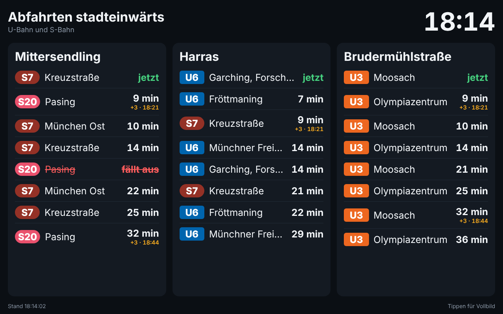

# Hösl Abfahrtstafel

Kiosk-Webapp für ein Tablet: zeigt die nächsten **U- und S-Bahnen stadteinwärts** ab
**Mittersendling**, **Harras** und **Brudermühlstraße**, gruppiert nach Station.
Daten kommen live von der MVG.



## Starten

```bash
docker compose up -d
```

Danach auf dem Tablet `http://<server-ip>:8080` öffnen und über das Browser-Menü
**„Zum Startbildschirm hinzufügen“** wählen. Die App startet dann im Vollbild
(PWA), hält den Bildschirm wach und aktualisiert sich alle 30 Sekunden.
Ein Tipp auf den Bildschirm schaltet in den Vollbildmodus, falls der Browser ihn verlassen hat.

Das Image wird von GitHub Actions gebaut und unter
`ghcr.io/derpfuscher1203/hoesl-abfahrtstafel` veröffentlicht (amd64 und arm64,
läuft also auch auf einem Raspberry Pi). Updates: `docker compose pull && docker compose up -d`.
Zum lokalen Bauen statt Ziehen: `docker compose up -d --build`.

> Ist das GHCR-Paket privat, vorher `docker login ghcr.io` ausführen oder das Paket
> in den GitHub-Paketeinstellungen auf „public“ stellen.

## Konfiguration

Alles steht in [`config/stations.json`](config/stations.json) und wird per Volume in den Container
gemountet; nach einer Änderung reicht `docker compose restart`.

| Feld | Bedeutung |
| --- | --- |
| `refreshSeconds` | Aktualisierungsintervall der Anzeige |
| `departuresPerStation` | Wie viele Abfahrten pro Station angezeigt werden |
| `transportTypes` | Verkehrsmittel (`UBAHN`, `SBAHN`, auch `TRAM`, `BUS` möglich) |
| `stations[].query` | Suchbegriff für die MVG-Stationssuche |
| `stations[].globalId` | Optional: feste MVG-ID (z. B. `de:09162:6`), überspringt die Suche |
| `stations[].directions.<TYP>.exclude` | Ziele, die stadtauswärts liegen und ausgeblendet werden |
| `stations[].directions.<TYP>.include` | Optional: nur diese Ziele anzeigen |

**Richtungsfilter:** Die MVG liefert keine Richtung „stadteinwärts“, nur das Fahrtziel.
Deshalb blendet die Konfiguration alle Züge aus, deren Ziel stadtauswärts liegt
(z. B. U3 nach Fürstenried West, U6 nach Klinikum Großhadern, S7 nach Wolfratshausen).
Der Vergleich ist tolerant gegenüber Groß-/Kleinschreibung, Umlauten und „Str.“.
Taucht ein neues Ziel auf, das falsch einsortiert wird, einfach in die passende Liste eintragen.

Umgebungsvariablen: `PORT` (Standard 8080), `CONFIG_PATH`, `MVG_MOCK=1` (Demo-Daten ohne Internet).

## Architektur

- `src/server.js`: kleiner Node-Server ohne Laufzeit-Abhängigkeiten. Liefert die Kiosk-Seite aus und `/api/departures`.
- `src/mvg.js`: Zugriff auf die öffentliche MVG-API (`https://www.mvg.de/api/bgw-pt/v3`, Endpunkte `locations` und `departures`).
- `src/board.js`: Abruf aller Stationen, Filterung, 20 s Cache (mehrere Tablets erzeugen keine Mehrlast).
  Ist die MVG nicht erreichbar, wird der letzte Stand als veraltet angezeigt.
- `public/`: Oberfläche (HTML/CSS/JS), Manifest und Service Worker für die Installation als App.
- `GET /healthz`: Health-Check für Docker.

## Entwicklung

```bash
npm ci
npm run dev    # Demo-Daten, http://localhost:8080
npm start      # echte MVG-Daten
npm run lint
npm test
```

## CI/CD

`.github/workflows/ci.yml`:

1. **Lint & Test** bei jedem Push und Pull Request.
2. **Docker Build & Smoke-Test**: baut das Image, startet es mit Demo-Daten und prüft Seite, API und Health-Check.
3. **Veröffentlichen** (nur Push auf `main` oder Tag `v*`): Multi-Arch-Image nach GHCR mit den Tags
   `latest`, `sha-<commit>` und bei Releases `1.2.3` / `1.2`.

Dependabot hält npm-Pakete, Actions und das Basis-Image aktuell.
